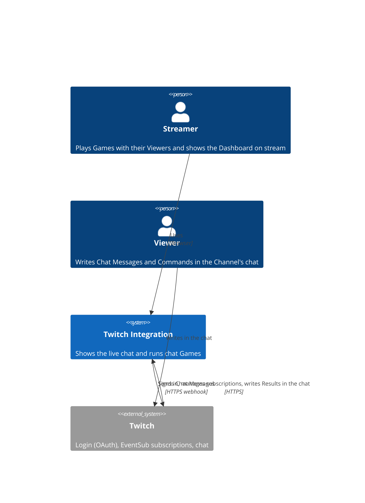
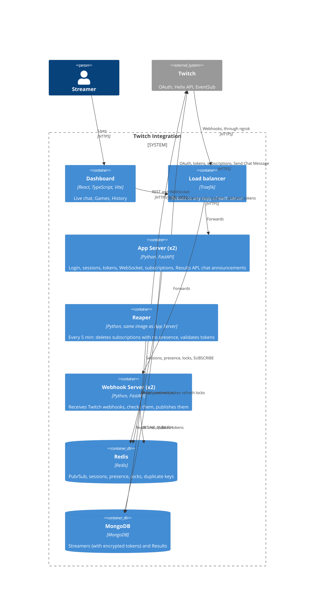

# Architecture

## The idea

Twitch sends every Chat Message of a Channel to our Webhook Server, which checks it and hands it to Redis Pub/Sub. The App Server forwards it over a WebSocket to the Streamer's Dashboard. The Games run inside the Dashboard, in the browser: only the Streamer is connected, so their page is the game engine, and the servers only move Chat Messages, keep sessions, store Results and write each Result in the chat as the Streamer.

The project is also built to learn two things: OAuth done the way large apps do it (server-side login, sessions, stored and refreshed tokens) and distributed systems. That is why it runs several copies of each server even locally.

Two rules shape the rest:

- **Scale out, not up.** No server keeps anything important in its own memory: it is in Redis or MongoDB. Any copy of a server can handle any request, so more copies can be added.
- **Nothing stays open forever.** A Twitch subscription exists only while the Streamer has a Dashboard open (plus 10 minutes), and a reaper deletes any subscription Twitch still has for a Streamer without one.

For now everything runs locally in docker-compose ([Hosting later](#hosting-later)).

## How the pieces fit together

### System context (C4 level 1)

The Streamer uses the app; Viewers only write in Twitch. The app talks to Twitch for the login, the subscriptions and the Chat Messages.



### Containers (C4 level 2)



docker-compose runs two copies of the App Server and two of the Webhook Server behind Traefik, which finds the copies by their Docker labels. Twitch reaches Traefik through an ngrok tunnel, so it only knows one address, and any Webhook Server copy can get any message: that is why duplicates are checked in Redis. Each Dashboard connects to any App Server copy, and no sticky sessions are needed.

Everything is served from one address, Traefik's, which routes by path: `/eventsub` to the Webhook Server; `/auth`, `/api` and `/ws` to the App Server; everything else to the Dashboard (a `web` container with Vite). Because the Dashboard and the App Server share one origin, the session cookie and the `Origin` check stay simple and no CORS is needed.

### The app access token

The app access token (Twitch's client credentials flow, with the client secret) is what creates, lists and deletes EventSub subscriptions. Each process that needs it, every App Server copy and the reaper, asks Twitch for one when it starts and keeps it in its own memory; if Twitch answers 401, it asks for a new one. This does not break "nothing important in memory": any process can get a new one at any time.

## Main flows

### Signing in

1. The Streamer clicks "Iniciar sesión con Twitch". The App Server saves a random `state` in Redis (`oauth_state:<state>`, 10 min) and redirects to Twitch with the scopes `user:read:chat`, `user:bot`, `channel:bot` and `user:write:chat`.
2. Twitch returns to `/auth/callback` with a code and the `state`. The App Server checks and deletes the `state`.
3. The App Server exchanges the code, with the client secret, for an access token and a refresh token, and reads the Streamer's id, login and display name.
4. It upserts the Streamer in MongoDB with both tokens encrypted ([ADR-0004](adr/0004-store-streamer-tokens-encrypted.md)) and deletes `needs_reauth:<streamer_id>` from Redis, if it exists.
5. It creates a new session (`session:<id>` in Redis), adds its id to `streamer_sessions:<streamer_id>`, and sends it in the `__Host-session` cookie ([ADR-0001](adr/0001-server-side-sessions-in-redis.md)).

### Opening the Dashboard

1. The Dashboard opens a WebSocket to the App Server. The App Server checks the cookie and the `Origin`. If `needs_reauth:<streamer_id>` exists, it tells the Dashboard to show the prompt to sign in with Twitch again, and stops here.
2. It gives the connection a new id, writes it in `active_dashboard:<streamer_id>` and publishes a "taken over" event on `chat:<streamer_id>`.
3. The App Server copy that holds an older connection of that Streamer gets the event, tells that Dashboard to show "Abierto en otra ventana" and closes it. The newest one is the Active Dashboard.
4. The App Server subscribes to `chat:<streamer_id>` on its single Pub/Sub connection, and sets `presence:<streamer_id>` (10 min).
5. It creates the `channel.chat.message` subscription in Twitch with the app access token, with the Streamer as broadcaster and as user, and the Webhook Server's public address as callback. If Twitch answers 409 (it already exists), that is fine.
6. Twitch sends the challenge to the Webhook Server, which answers it, and the subscription is active.
7. While the WebSocket is open, the App Server renews the presence every 30 seconds and pings every 30 seconds; it closes the WebSocket after 60 seconds without an answer and then unsubscribes from the channel.

### A Chat Message reaches the Dashboard

1. A Viewer writes in the chat. Twitch POSTs a `notification` to the Webhook Server.
2. The Webhook Server verifies the signature; if it is wrong, it answers 403.
3. If the timestamp is more than 10 minutes old, it does not publish it, but still answers 2xx so Twitch does not count a failure.
4. It runs `SET seen:<message_id> 1 NX EX 600`. If the key already existed, it is a duplicate: not published.
5. It turns the event into the app's Chat Message format (id, Viewer id, Viewer name, color, text, date) and publishes it on `chat:<broadcaster id>`.
6. It answers 2xx. Steps 2 to 5 are all it does before answering.
7. The App Server copy subscribed to that channel sends the Chat Message over the WebSocket. The Dashboard shows it in the live chat (the last 200 are kept, only in memory) and passes it to the Game of the Round in progress.

Chat Messages that arrive while no Dashboard is connected are lost ([ADR-0002](adr/0002-chat-delivery-with-redis-pub-sub.md)).

### Playing a Round

1. The Streamer opens a Game's tab and starts a Round (for Voting, they write 2 to 6 options first). Only one Round can be going at a time.
2. The Game receives each Chat Message and reacts to its Commands: `!vote <letter>` or `!join`, case-insensitive, extra spaces ignored. A Viewer's last vote counts; a Viewer enters a Giveaway once; the Streamer cannot enter their own Giveaway.
3. The Round's state is saved in `localStorage` after each change, so a page reload does not lose it.
4. The Round ends when the Streamer stops it or, in Voting, when its optional timer runs out. A Giveaway winner is drawn in the browser with `crypto.getRandomValues`; "elegir otro" draws again without repeating a winner.
5. The Dashboard POSTs the Result to the App Server, which saves it in MongoDB. The Round is removed from `localStorage`.
6. If "Anunciar en el chat" is checked (it is by default), the App Server writes the Result in the Channel's chat as the Streamer (`POST /helix/chat/messages` with their access token), for example "🎉 Ganó @SomeViewer". If it fails, the Result is still saved and the Dashboard shows a warning.
7. The History tab lists the Results, newest first.

### Using and refreshing the Streamer's token

1. Before calling Twitch as the Streamer, the App Server decrypts the access token. If it has expired or is about to, it refreshes it first.
2. To refresh, it takes `SET refresh_lock:<streamer_id> NX EX 30` in Redis. If another copy already holds it, it waits a moment and reads the new token from MongoDB instead.
3. With the lock, it sends the refresh token and the client secret to Twitch, gets a new access token and a new refresh token, saves both encrypted and releases the lock.
4. If Twitch rejects the refresh token (400 or 401: the Streamer changed their password or disconnected the app), it sets `needs_reauth:<streamer_id>`: the same as a revocation.
5. If Twitch answers 401 to a call made with the token, it refreshes once and retries once.

### Revocation

1. If the Streamer removes the app's permissions, or Twitch cancels the subscription, Twitch POSTs a `revocation` to the Webhook Server, with the reason in `subscription.status`.
2. The Webhook Server verifies the signature. It only talks to Redis, never to MongoDB. What it does depends on the reason:
   - `authorization_revoked` or `user_removed` (the Streamer's permission is gone): it sets `needs_reauth:<streamer_id>` in Redis (no expiry) and publishes a "reauthorization required" event on `chat:<streamer_id>`. An open Dashboard shows a prompt to sign in with Twitch again; a Dashboard opened later sees the same prompt (see "Opening the Dashboard"). Signing in deletes the key.
   - Any other reason, such as `notification_failures_exceeded` (our servers failed too many times) or `version_removed`: the permission is still fine, so it only publishes a "subscribe again" event on `chat:<streamer_id>`. The App Server copy that holds the Active Dashboard creates the subscription again. If no Dashboard is open, nothing is done: the next one creates it.

### Reaper

1. Every 5 minutes, the reaper asks Twitch for the list of all our EventSub subscriptions.
2. For each one, it checks `presence:<streamer_id>` in Redis.
3. It deletes in Twitch every subscription whose Streamer has no presence. At worst, an unused subscription lives about 15 minutes (10 of presence + 5 until the next run). It also deletes every subscription whose callback is not the current webhook address (for example, after the tunnel's address changed): Twitch answers 409 only for the same callback, so an old one would otherwise stay.
4. It validates with Twitch (`GET https://id.twitch.tv/oauth2/validate`) every stored token whose last validation is more than an hour old, as Twitch requires. An expired one is refreshed (as above); one that cannot be refreshed sets `needs_reauth:<streamer_id>`.

It is the App Server's image run with another command (`python -m reaper`), as one docker-compose service. docker-compose has no scheduler, so the process runs in a loop and sleeps 5 minutes between runs.

### Deleting the account

The App Server does, in order: delete the Streamer's subscriptions in Twitch, revoke their token at Twitch (`POST https://id.twitch.tv/oauth2/revoke`), delete their Results, their Redis keys (every session listed in `streamer_sessions:<streamer_id>`, that set, and `needs_reauth`) and their Streamer record. The subscriptions go first so no revocation arrives after the account is gone. Each step skips what no longer exists, so a failed deletion can be retried.

## Technologies

| Part | Technology | Why | ADR |
|---|---|---|---|
| Dashboard | React, TypeScript, Vite | Known by the team; the Games run in it | — |
| App Server, Webhook Server, Reaper | Python, FastAPI | Known by the team; async for WebSockets and webhooks | — |
| Sessions | Random id in a cookie, session in Redis | Any copy can read it, logout is instant, runs locally | [0001](adr/0001-server-side-sessions-in-redis.md) |
| Chat delivery | Redis Pub/Sub | Simple; losing a few messages on reconnect is accepted | [0002](adr/0002-chat-delivery-with-redis-pub-sub.md) |
| Database | MongoDB (official `mongo` image locally) | Each Game's Result has its own shape | [0003](adr/0003-mongodb-atlas-as-database.md) |
| Twitch | EventSub `channel.chat.message`, webhook transport, app access token | The subscriptions do not need the Streamer's token | — |
| Streamer's tokens | Stored in MongoDB, encrypted with AES-GCM (Python `cryptography`) | Needed to write in the chat as the Streamer | [0004](adr/0004-store-streamer-tokens-encrypted.md) |
| Local stack | docker-compose | Runs every piece with one command | — |
| Load balancer | Traefik | Configured with labels in `docker-compose.yml`; finds the copies of each server by itself; supports WebSocket | — |
| Public address for webhooks | ngrok free dev domain | The address stays the same across restarts, so subscriptions keep working; free | — |
| Fake Twitch events | Twitch CLI (`twitch event trigger`) | Tests the Webhook Server without Twitch | — |
| CI | GitHub Actions | Lint, typecheck and tests on every pull request | — |

ngrok's free plan has monthly limits (20,000 HTTP requests and 1 GB of data out, as of November 2026). Each Chat Message is one request, so a busy Channel uses it up fast. If it runs out, a Cloudflare quick tunnel is free with no such limit, but its address changes on each start, so the subscription has to be created again.

The API contract lives in code: FastAPI's OpenAPI at `/docs` of each server.

## Hosting later

The app is not hosted yet: it is decided when there is budget. What was discussed, as a starting point:

- **The "correct" setup on AWS:** the Dashboard on S3 + CloudFront; the App Server and the Webhook Server on ECS Fargate behind one ALB (one host name each); the reaper as an ECS scheduled task; Redis on ElastiCache; MongoDB on Atlas; secrets in SSM Parameter Store; Terraform in `infra/`; deploys from GitHub Actions with OIDC. To avoid paying for a NAT Gateway, the tasks would run in public subnets, reachable only from the ALB, and Atlas would accept any IP with a strong password and TLS. A Lambda cannot be the reaper there: inside the VPC it has no internet without NAT, and outside it cannot reach ElastiCache.
- **The cheapest setup:** one small VM that runs this same docker-compose, with Caddy for HTTPS and cron for the reaper.
- **Free managed services, with limits:** MongoDB Atlas Free (512 MB) and Redis Cloud Free (30 MB, 30 connections, 100 operations per second). Each Chat Message is 2 Redis operations, so Redis Cloud Free tops out near 50 Chat Messages per second in total.

Because the servers keep nothing in memory, moving to any of these does not change the app.

## Repository

```
apps/
  web/              The Dashboard: React + TypeScript + Vite; the Games live in src/games/, one file each
  app-server/       FastAPI: login, sessions, tokens, WebSocket, subscriptions, Results API, chat announcements; also the reaper (python -m reaper)
  webhook-server/   FastAPI: receives Twitch webhooks, checks them and publishes them to Redis
infra/              Empty until hosting is decided
scripts/            Helper scripts, such as sending fake events with the Twitch CLI
docs/               Non-functional requirements, architecture, data model and ADRs
docker-compose.yml  Every piece, for running locally: Traefik, the Dashboard (web), two copies of each server, the reaper, Redis and MongoDB
.env.example        The names of the environment variables, with no values
```
