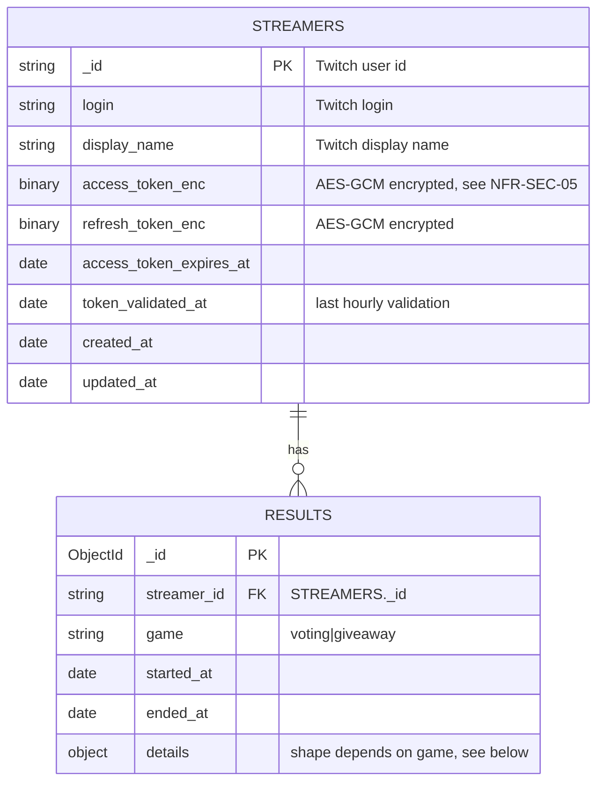

# Data model

MongoDB, two collections ([ADR-0003](adr/0003-mongodb-atlas-as-database.md)). Short-lived state lives in Redis (see the end of this doc).



## Entities

| Entity | Why it exists |
|--------|---------------|
| STREAMERS | The Streamer who signed in: who they are, and their Twitch tokens, encrypted, to write in their chat ([ADR-0004](adr/0004-store-streamer-tokens-encrypted.md)). |
| RESULTS | What is kept when a Round ends, shown in the History tab. |

## Rules the diagram cannot show

- Index `RESULTS { streamer_id: 1, ended_at: -1 }`: History lists a Streamer's Results, newest first.
- MongoDB has no foreign keys or cascades. Deleting an account deletes the Results first and the Streamer last ([NFR-PRIV-03](non-functional-requirements.md#privacy-priv)).
- `details` for `voting`:
  ```json
  { "options": [{ "letter": "A", "text": "Pizza", "votes": 12 }], "winners": ["A"] }
  ```
  2 to 6 options, letters A to F. `winners` has more than one letter when there is a tie, and is empty when nobody voted.
- `details` for `giveaway`:
  ```json
  { "entries": 42, "winner": { "viewer_id": "123", "display_name": "SomeViewer" } }
  ```
  `winner` is `null` when nobody entered. The list of entrants is never kept ([NFR-PRIV-02](non-functional-requirements.md#privacy-priv)).
- Chat Messages are never stored ([NFR-PRIV-01](non-functional-requirements.md#privacy-priv)).

## Redis keys

| Key | Value | Expires | What it is for |
|---|---|---|---|
| `session:<session_id>` | The Streamer id and the login time | 24 h without use, and never later than 7 days after login | The Streamer's session ([ADR-0001](adr/0001-server-side-sessions-in-redis.md)) |
| `streamer_sessions:<streamer_id>` | A set with the ids of the Streamer's sessions | 7 days, renewed on each login | Deleting the account ends every session of the Streamer, in every browser ([NFR-PRIV-03](non-functional-requirements.md#privacy-priv)). An id may point to a session that already expired; that is harmless |
| `oauth_state:<state>` | `1` | 10 min | The OAuth `state` check |
| `seen:<message_id>` | `1`, set with `NX` | 10 min | Duplicate detection: `message_id` is `Twitch-Eventsub-Message-Id` |
| `presence:<streamer_id>` | `1` | 10 min, renewed every 30 s while the Active Dashboard is connected | Tells the reaper the Streamer still has a Dashboard |
| `active_dashboard:<streamer_id>` | The id of the newest WebSocket connection | Same as presence | Which Dashboard is the Active Dashboard |
| `refresh_lock:<streamer_id>` | The id of the App Server copy that is refreshing | 30 s | Only one copy refreshes a Streamer's token at a time ([NFR-REL-05](non-functional-requirements.md#reliability-rel)) |
| `needs_reauth:<streamer_id>` | `1` | Never; deleted when the Streamer signs in again | The Streamer's permission is gone (a revocation for `authorization_revoked` or `user_removed`, or a refresh token Twitch rejects): the Dashboard asks them to sign in again. Set by the Webhook Server or the App Server |
| `chat:<streamer_id>` | Pub/Sub channel, not a key | — | Delivers events from the Webhook Server (and the App Server) to the App Server copy that holds the Streamer's Active Dashboard ([ADR-0002](adr/0002-chat-delivery-with-redis-pub-sub.md)) |
